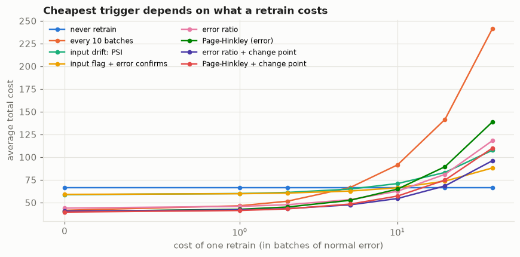
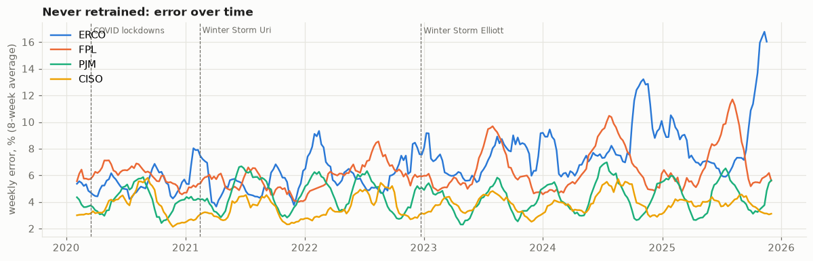

# retrain-trigger

**When should a data scientist be told to retrain a model, and how should they retrain it?**

Models go stale: the world they learned from changes. Most monitoring watches for **input drift**
("the data coming in looks different"). But inputs can change without hurting the model, and the
model can break while the inputs look exactly the same. This project compares retraining triggers by
**what they cost and what they save**: first on simulated data where the timing and harm of every
change is known, then on real electricity-demand forecasting for 12 US grid operators, 2019-2025.

| Notebook | Question |
|---|---|
| [1 · Triggers](notebooks/01_triggers.ipynb) | Which signal should page a data scientist? |
| [2 · Retrain actions](notebooks/02_retrain_actions.ipynb) | New weights, new hyperparameters, or keep training? |
| [3 · Grid load](notebooks/03_grid_load.ipynb) | Does it hold on real data? |

## 1 · Simulation: six kinds of change, 30 streams each

A model is trained, then watched over 60 batches (think: weeks). Halfway through, the world changes in
one of six ways: nothing; inputs move harmlessly; inputs move where the model never learned; the
**meaning** changes (same inputs, different right answer) suddenly, gradually, or into something more
complex. True answers come back 2 batches late. **Every trigger's threshold is set to the same
false-alarm rate** on separate drift-free streams, so "more sensitive" isn't mistaken for "better".

| Trigger | Meaning changed: caught | Wasted retrains when inputs moved harmlessly |
|---|---|---|
| Input drift (PSI, KS test, classifier test, prediction drift) | 7-10% of streams (= their false-alarm rate) | about 3 per stream |
| Industry rule "PSI > 0.2" | never | 3 per stream |
| Model error rose (error ratio, Page-Hinkley) | **100%, within 2-5 batches** | 0.1 or fewer |

- **Input-drift alarms are blind to a change in meaning** and pay for retrains that don't help. They do
  win when inputs move into new territory, because they fire before any true answers come back.
- **Detecting fast isn't enough: retrain on the right data.** After a sudden change, the error trigger
  noticed within 2 batches but retrained on a window that was mostly *pre-change* data. Retraining only
  on data since the estimated change point (from the Page-Hinkley statistic) cut its cost from 62.9 to
  43.0, close to an oracle that knows the change date (38.9).

**Which trigger is cheapest** depends on what a retrain costs (in batches of normal prediction error):

| Retrain price | 0-2 | 5-10 | 20+ |
|---|---|---|---|
| Cheapest trigger | Page-Hinkley + change point | error ratio + change point | never retrain |

Input-drift triggers are never the cheapest, at any price.



## 2 · Retrain how?

| Action | Effect |
|---|---|
| Refit (same hyperparameters, new data) | the default; fresh data does most of the work |
| Re-tune hyperparameters | **15-22% lower error when the world became more complex**; 1-6% elsewhere |
| Warm start (add trees to the old model) | worst everywhere; **4-5x worse after inputs moved** |

The warm-start failure is a library behaviour worth knowing: scikit-learn's histogram gradient boosting
re-learns its feature binning on the new data but, while adding trees, evaluates the old trees on the
new bins (read in the library source). The damage grows with the shift: error 0.07 / 0.96 / 2.58 at
shifts of 0 / 1 / 4, against 0.01 for a fresh fit. It is documented in one line ("for results to be
valid, the estimator should be re-trained on the same data only") but nothing warns at run time.
**With this model, after drift, refit.**

## 3 · Real data: day-ahead electricity demand

A deliberately simple forecaster (calendar + recent demand, no weather) per operator, trained on 2019,
used week by week to 2025. No known "right" retrain dates, so every trigger's threshold is **chosen on
2020-21** (COVID, Winter Storm Uri) and **scored once on 2022-25** (Winter Storm Elliott, fast growth).

- **Never retraining mostly holds up**, except where demand **grew past the training range**: ERCOT's
  error rose from 5% to 9%. Tree models can't extrapolate, so growth is the drift that matters here.
- **Input-drift alarms, as usually configured, are noise on weather-driven data.** On ordinary weeks PSI
  reads 4-7 (a week has only 7 values of each daily feature, too few to fill 10 bins), and even comparing
  4 weeks with the same weeks a year earlier gives a median of 1.1-1.9, against the 0.2 rule of thumb.
  Such alarms either fire every week or, set high enough to stay quiet, never fire.
- **Performance triggers are the safe default:** they fire rarely (ERCOT once or twice) and save a little
  at low and medium retrain prices. Savings vs never retraining are small, 2-5% of total error.
- **The change-point trick does not transfer:** on seasonal data a few weeks of post-change data lose
  the yearly cycle, and error jumps from 4-7% to 6-26%. Keeping a full year and weighting the post-change
  weeks fixes the failure but doesn't beat the plain triggers (and gives back the simulated benefit).
- **One threshold shared by all operators beats a threshold per operator**: two years of one operator's
  history is too little to tune on.

### With weather: a stronger model is more fragile

Adding hourly temperature (Open-Meteo archive, one city per operator, used as a perfect next-day
forecast) cuts error substantially, but ERCOT's error now climbs from 3.4% to **14.3%** by 2025 (vs 5.2%
to 9.3% without weather): the model leans on the temperature-to-demand relationship, and growth changes
exactly that. Retraining is now worth **14-17%** of total error (vs 2-5%):

| Retrain price (weeks of normal error) | 1 | 4 | 16 |
|---|---|---|---|
| Classifier two-sample test (input drift, AUC > 0.99) | **+19.0** [+4.3, +41.2] | **+15.9** [+1.8, +37.2] | +3.2 [-10.4, +22.4] |
| Fixed schedule (every 2 years) | +17.5 [+4.1, +37.5] | +14.9 [+1.4, +35.0] | +4.5 [-9.4, +25.4] |
| Page-Hinkley (error) | +12.9 [+1.2, +30.8] | +12.3 [+0.8, +30.1] | **+10.2** [-0.9, +27.2] |
| Error ratio | +5.3 [-0.0, +12.3] | +5.2 [-0.0, +12.1] | +4.4 [-0.0, +10.9] |
| Seasonal PSI | 0 (never fires) | 0 | 0 |

Saving vs never retraining (total 113.7). Here an **input-drift** check wins: a classifier looking at all
inputs together notices that the *combination* of temperature and demand has moved. So the simulation's
"input drift is never the best signal" holds for the simple model but not the stronger one: **which
signal to page on depends on the model, not just the data.**

| Retrain price (weeks of normal error) | 1 | 4 | 16 |
|---|---|---|---|
| Fixed schedule (every 2 years) | **+6.5** [+1.2, +14.4] | +2.7 [-3.0, +10.7] | -12.6 [-20.0, -3.5] |
| Page-Hinkley (error) | +3.9 [+0.0, +9.9] | **+2.7** [+0.1, +6.9] | -0.1 [-3.1, +3.7] |
| Error ratio | +3.8 [+0.2, +9.4] | +2.1 [-0.0, +6.4] | **+1.6** [-0.0, +4.7] |
| Weekly PSI on inputs | -24.9 | -123.4 | -517.2 |

Saving against never retraining (total 133.7), summed over 12 operators, 95% interval from resampling
operators. Positive = cheaper than never retraining.



## What to take away

1. **Page on performance** when true answers come back reasonably fast. If you watch inputs, prefer a
   multivariate check (a classifier telling old data from new) over per-feature PSI, and calibrate it
   on your own data: the 0.2 rule can be meaningless. Test both on your model: a stronger model can
   depend on exactly the input combinations that drift.
2. **Price the retrain.** The right trigger, and whether to retrain at all, depends on it.
3. **Retrain on the right data**, and re-tune hyperparameters when the relationship got more complex.
4. **Don't warm-start a histogram gradient-boosting model on shifted data.**
5. **Check simulation lessons against real structure**: seasonality broke the change-point window, and
   a stronger model reversed the verdict on input drift.

## Method notes

- Synthetic: 30 test streams per scenario, 50 separate calibration streams; intervals are bootstrap over streams.
- Real: thresholds chosen by total cost over 2020-21, scored on 2022-25; a single threshold is shared by all
  operators (a per-operator threshold would need more history than two years gives).
- Real-data threshold grids were widened once after the first pass showed the chosen values sitting at
  the grid edges; both passes are in `results/real_runs.json`.
- The main forecaster has no weather inputs; its errors (3-9%) are well above an operator's own forecast.
  The weather variant uses *observed* temperature at one city per operator as a perfect forecast: an
  upper bound on what weather adds, and a crude proxy for multi-state operators.
- Weather data: Open-Meteo historical archive (CC BY 4.0, non-commercial use), fetched at runtime.

## Run

```bash
python3 -m venv .venv && source .venv/bin/activate
pip install -r requirements.txt -r requirements-dev.txt && pip install -e .
pytest -q
python -m retrain.experiment                  # synthetic study (~8 min on 11 cores)
python -m retrain.realdata && python -m retrain.realdata --extra && python -m retrain.realdata --seasonal
python -m retrain.realdata --cpw && python -m retrain.realdata --weather
python notebooks/build.py                     # then execute each notebook
```

Real data: EIA-930 hourly demand (public domain), read from the grid-mining project's parquet
(`GRID_MINING_DIR` to point elsewhere).
