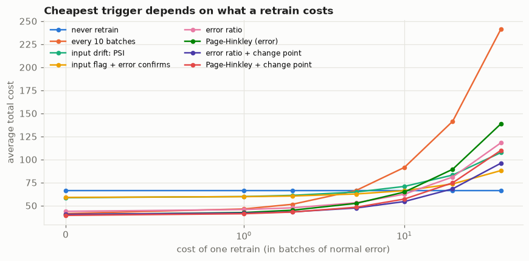
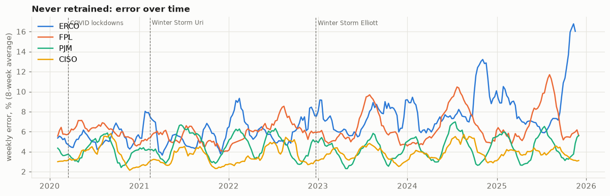

# The drift alarm that never rang: when should you actually retrain a model?

*Draft, 2026-10-17. Images use raw GitHub URLs for godot107/retrain-trigger on `main`; they render once
the repository is public.*

Every machine-learning model is trained on the past and used in the future. When the future stops
looking like the past, the model goes stale, and someone has to retrain it. The industry answer to
"when?" is usually a **drift monitor**: watch the data coming in, and raise an alarm when it looks
different from the data the model learned from.

I wanted to know whether that alarm rings at the right times. So I built a test bench where I control
exactly when and how the world changes, compared a dozen retraining rules on cost, and then ran the same
rules on seven years of real electricity-demand forecasting. The short version: **the most common alarm,
a per-column drift score, watches the wrong thing**, and on real data it was mostly noise. What worked
better depended on the model, which was the most interesting finding.

## Two kinds of change

Imagine a model that predicts how long a delivery takes from distance and time of day.

- If the company starts delivering more in the suburbs, the *inputs* change: more long distances. If the
  model has seen long distances before, it is still right. This is **input drift**, and it may not matter.
- If a new road opens, the same distance now takes less time. The inputs look exactly as before; what
  they *mean* has changed. This is **concept drift**, and the model is now wrong.

Most drift monitors watch the inputs. The most common score, the Population Stability Index (PSI),
compares the distribution of each input today with the training data, and a rule of thumb says PSI above
0.2 means "significant drift".

## The test bench

I simulated six situations, 30 times each: nothing changes; inputs move but the model copes; inputs move
somewhere the model never learned; the meaning changes suddenly; gradually; or into something more
intricate. A model is trained, then watched batch by batch, and the true answers come back two batches
late, as they do in real life.

Then I tried thirteen retraining rules. Some watch the inputs (PSI, a statistical test, a classifier
that tries to tell old data from new), some watch the model's predictions, and some watch the model's
**error**, once the true answers come back. To keep it fair, I set every rule's threshold so it raises
false alarms at the same rate on data where nothing changes. Otherwise "more sensitive" looks like
"better".

## What happened

**The input alarms never noticed the meaning change.** When the same inputs started to mean something
different, PSI and its relatives stayed quiet; the occasional alarm was just their normal false-alarm
rate. The "PSI above 0.2" rule never fired at all. And when inputs moved somewhere harmless, they fired
anyway: about three unnecessary retrains each time.

**The error-based alarms caught every harmful change**, within two to five batches, and almost never
retrained for nothing. Their only requirement is that true answers come back.

**Detecting fast wasn't enough.** The simple error alarm noticed a sudden change within two batches, yet
cost far more than a rule that knew the exact change date. The reason: it retrained on the most recent
ten batches, most of which were from *before* the change. The fix comes from an old quality-control
method, the Page-Hinkley test: its running sum of excess error has its lowest point just before the
change began. Retraining only on data after that point brought the cost from 62.9 to 43.0, close to the
all-knowing rule's 38.9.

**Which rule is cheapest depends on what a retrain costs.** If retraining is nearly free, retrain
eagerly on error; if it is moderately expensive, be pickier; if it is very expensive, it can be cheaper
never to retrain. The input-drift rules were never the cheapest, at any price.

## How to retrain

I also compared three ways of retraining: refit with the same settings on fresh data; search for new
settings ("hyperparameters") too; or keep the old model and add to it ("warm start").

Fresh data did most of the work. Searching for new settings mattered only when the world got more
complicated (15-22% lower error there, 1-6% elsewhere).

Warm start was the surprise: four to five times *worse* after the inputs moved. Reading the library's
source code (scikit-learn's histogram gradient boosting) explained it: on each fit, it re-learns how to
bucket each input from the new data, but evaluates the old trees on the new buckets while adding trees.
The documentation does say "the estimator should be re-trained on the same data only", in one line;
nothing warns at run time.

## Real data: seven years of electricity demand

Simulations are only useful if they survive contact with real data. I built a deliberately simple
day-ahead forecaster for 12 large US grid operators (calendar and recent demand) and replayed 2019-2025
week by week: COVID lockdowns, Winter Storms Uri and Elliott, and fast demand growth in Texas. With no
known "right" retrain dates, every rule's threshold was chosen on 2020-21 and scored once on 2022-25.

Three things stood out.

**Most models held up.** Without any retraining, most operators' error barely moved. The exception was
Texas (ERCOT): demand grew past anything in the training year, and a tree model cannot predict values
it has never seen. Its error went from 5% to 9%.

**The PSI alarm was pure noise.** On an ordinary week, PSI read 4 to 7, twenty to thirty-five times
the 0.2 rule. Part of that is arithmetic: a week contains only seven values of a daily feature, too few to
fill PSI's ten bins. Part is weather: even comparing four weeks with the same four weeks a year earlier,
the median was above 1. Such an alarm either rings every week or, set high enough to stay quiet, never
rings.

**The error alarms were the safe default**, but the savings were small: 2-5% of total error compared
with never retraining, mostly from Texas. And the change-point trick that won in simulation backfired:
a few weeks of post-change data lose the yearly cycle that electricity demand depends on.

## Then I gave the model the weather

No real operator forecasts electricity without the weather, so I added hourly temperature from the
Open-Meteo archive. (I first used the temperature that actually happened, a perfect forecast; rerunning
with the day-ahead forecasts that were really available raised the error by about 5% and changed none of
the conclusions.) The model got much better: Texas's error in 2020 dropped from 5.2% to 3.4%.

And then it drifted *faster*. By 2025, the weather-aware model's Texas error was 14.3%, against 9.3% for
the simple one. It had learned a precise relationship between temperature and demand, and demand growth
changes exactly that relationship. A better model can be a more fragile one.

With the fragile model, retraining was worth far more, 14-17% of total error instead of 2-5%, and the
best alarm was one that watches the *inputs*: not PSI, but a classifier trained to tell recent weeks from
the training data. It notices when the combination of temperature and demand has moved, which is precisely
what the model depends on. The verdict from my simulation ("input drift is never the best signal") held
for the simple model and flipped for the stronger one.

## Packaging it as a monitor

The monitor itself is small. I packaged the winning rules as a weekly AWS Lambda function, ready to
deploy but not running anywhere yet. The design: the forecasting job drops its predictions and, a week
later, the actual demand into S3; the function updates the score and emails a data scientist when it
fires, with its estimate of when the change began. By AWS list prices it would cost cents a month. I
replayed six years (310 weeks) of Texas data through the function's code on my own machine, and it gave exactly
the same scores, and the same first alarm (February 2022), as the offline experiment.

## What I'd tell a team

1. **Page on performance** when true answers come back reasonably fast. If you watch inputs, watch them
   together (a classifier that tells old data from new), not one PSI per column, and calibrate on your
   own data; "0.2" can be meaningless.
2. **Put a price on a retrain.** The right rule, and whether to retrain at all, depends on it.
3. **Retrain on the right data**: after the change, but enough of it to keep the patterns that matter
   (seasons, here).
4. **Re-tune the settings when the problem got harder**; otherwise fresh data is enough.
5. **Check simulation lessons against real data.** Two of mine (the change-point window, and that input
   drift is never the best signal) did not survive.

The code, simulations and notebooks are at github.com/godot107/retrain-trigger.
